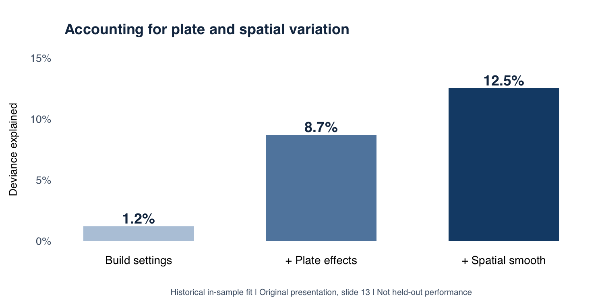

# Sandia Data Challenge

**Modeling where manufacturing scrap occurs, and which build settings are associated with lower risk.**

2025 Sandia Data Challenge · **Top 10 of 40 teams** · Team **Cluster Commanders**

**R · binomial GAMM · spatial smoothing · random effects · model diagnostics**

An analysis of additively manufactured parts, combining dimensional quality rules with a spatial statistical model. The goal was to compare powder type and build configurations while accounting for nonlinear position effects and differences between build plates.

[Modeling and validation](MODELING.md) · [Main analysis](without%20R.R) · [My contributions](#my-contributions)

## Results at a glance

| Evidence | Result | Interpretation |
| --- | --- | --- |
| Model sample | **1,448 observations** in the archived final model summary | The main script excludes build plate R before fitting |
| Model progression | Deviance explained: **1.2% → 8.7% → 12.5%** | Adding plate random effects and a spatial smooth improves in-sample fit |
| Lowest fixed-effects-only estimate | **5.2%** for virgin powder, 6×6 layout, no test artifacts | A model-based comparison, not an observed production improvement |
| Adjusted parameter evidence | Layout/TA and powder coefficients have **p-values of 0.375, 0.770, and 0.405** | The configuration ranking remains exploratory |
| Team outcome | **Top 10 of 40 teams** | Competition result, separate from model performance |

*Recreated from the team's original presentation, slide 13. These are historical fit diagnostics, not held-out predictive scores. [Details and limitations →](MODELING.md#validation-and-recorded-results)*

## Why this model?

A raw scrap-rate comparison can mix together material differences, part placement, and plate-to-plate variation. I used a **binomial generalized additive mixed model (GAMM)** to represent those sources separately:

- **Binary outcome:** a part is scrap if it violates a critical dimensional tolerance or is flagged as nonconforming.
- **Build settings:** powder type plus a three-level layout/test-artifact factor. Combining layout and test-artifact status avoids trying to estimate an unsupported independent effect when the observed design is confounded.
- **Nonlinear location:** a tensor-product spline over row and column learns a smooth risk surface across the plate.
- **Plate variation:** a random intercept captures shared variation among parts from the same plate.

The model is additive on the log-odds scale. The spatial term represents joint row/column structure; it does not establish powder-by-layout or powder-by-position interactions. [Read the specification →](MODELING.md#model-specification)

## My contributions

**Zichen (Joe) Zhu — statistical modeling, analysis, and visualization.**

- Implemented R data preparation: standardized the virgin/recycled inputs, encoded dimensional scrap rules, and constructed model features.
- Built the binomial GAMM and compared fixed-effects, plate-effect, and spatial-model specifications.
- Created build-plate visualizations, predicted-risk heatmaps, calibration plots, and residual diagnostics to explain model behavior.
- Presented the modeling findings and limitations to Sandia National Laboratories staff as part of the team submission.

This was a three-person project with **Sam Wang and Rohit Iyer**. Competition placement and the final presentation are team outcomes. This repository documents my analysis work within that collaboration; it does not claim sole ownership of the entire submission.

## Explore the repository

| File | Purpose |
| --- | --- |
| [MODELING.md](MODELING.md) | Specification, recorded results, interpretation, and reproduction boundaries |
| [without R.R](without%20R.R) | Main GAMM analysis, model comparison, prediction surfaces, and diagnostics |
| [A-K.R](A-K.R), [L-R.R](L-R.R) | Build-plate maps of scrap locations and test artifacts |
| [Buildplate_Heatmap.R](Buildplate_Heatmap.R) | Exploratory spatial scrap-rate maps |
| [Recycled vs Virgin.R](Recycled%20vs%20Virgin.R) | Descriptive powder comparison |
| [Virgin_vs_Recycled_Distribution.R](Virgin_vs_Recycled_Distribution.R) | Supplementary particle-size distribution analysis |
| [render_showcase_figure.R](render_showcase_figure.R) | Recreates the summary graphic from explicitly recorded slide values |

## Reproduction status

The original scripts are exploratory RStudio analyses and depend on competition data loaded into the session. Input datasets are not included in the current repository tree. The documentation update checked the scripts and archived presentation; it did not rerun model fitting or create a new train/test experiment. [Setup and known limitations →](MODELING.md#running-the-archived-analysis)
